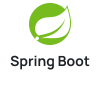
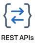

<!-- You found the source. The penguin insists this counts as code review. -->
<h1 id="top">
  
  <picture>
    <source media="(prefers-color-scheme: dark)" srcset="assets/profile/intro-title-dark.svg">
    
  </picture>
</h1>

**I'm Shaikh Mahad Ud Din**, a developer based in Karachi, Pakistan, focused on **Java backend development**.

I started programming with C++ in school. What kept me interested was the problem-solving: getting stuck, tracking down a mistake, and finally understanding why something works. That same curiosity eventually drew me toward what happens behind an application.

My focus is **Java, Spring Boot, REST APIs, and relational databases**. I like tracing a request through business logic, security checks, and database queries. I’m also interested in **system design**: where responsibilities belong and how components communicate. Before adopting a pattern, I want to understand the problem it solves and the trade-offs it introduces.

A little more about me

Most of my work so far has been in repositories I started myself. I’d like to contribute to **open-source Java projects** and learn how maintainers organize code, review changes, and decide what belongs.

I also enjoy the conversations that come with sharing work. If someone spots a simpler solution or asks why I made a particular choice, I want to understand their reasoning, explain mine, and improve the result.

## Backend stack

  <a href="https://dev.java/"><picture><source media="(prefers-color-scheme: dark)" srcset="assets/profile/stack/java-lockup-dark.svg"></picture></a>
  <a href="https://spring.io/projects/spring-boot"><picture><source media="(prefers-color-scheme: dark)" srcset="assets/profile/stack/spring-lockup-dark.svg"></picture></a>
  <a href="https://www.postgresql.org/"><picture><source media="(prefers-color-scheme: dark)" srcset="assets/profile/stack/postgresql-lockup-dark.svg"></picture></a>
  <a href="https://developer.mozilla.org/en-US/docs/Glossary/REST"><picture><source media="(prefers-color-scheme: dark)" srcset="assets/profile/stack/rest-api-lockup-dark.svg"></picture></a>
  <a href="https://junit.org/"><picture><source media="(prefers-color-scheme: dark)" srcset="assets/profile/stack/junit-lockup-dark.svg"></picture></a>
  <a href="https://spring.io/projects/spring-security/"><picture><source media="(prefers-color-scheme: dark)" srcset="assets/profile/stack/spring-security-lockup-dark.svg"></picture></a>
  <a href="https://git-scm.com/"><picture><source media="(prefers-color-scheme: dark)" srcset="assets/profile/stack/git-lockup-dark.svg"></picture></a>

More from my toolkit

Java and Spring Boot are my main backend tools, with PostgreSQL for relational data. I pay attention to how an endpoint handles invalid input, what its errors tell the caller, and the queries it runs to produce a response.

<!-- Add tools to the category where they are used; add a row when a new area needs one. -->

| Area | Technologies & concepts |
| :--- | :--- |
| **Programming foundations** | C++ · Kotlin · DSA · OOP |
| **APIs & persistence** | HTTP/REST · Spring Data JPA · Hibernate · MapStruct · OpenAPI |
| **Data & migrations** | SQL · MySQL · Flyway |
| **Development workflow** | Git · GitHub · Maven · Postman · IntelliJ IDEA |

**Currently exploring:** JUnit · Spring Security · Java internals · design patterns · SQL query performance.

## Selected projects

<h3 id="deploylatch"><a href="https://github.com/codewithmahad/deploylatch"><picture><source media="(prefers-color-scheme: dark)" srcset="https://cdn.jsdelivr.net/gh/codewithmahad/deploylatch@5c9f7a45866382327fe0de5911df684a2674dec8/docs/assets/deploylatch-mark-on-dark.svg"></picture>DeployLatch&nbsp;↗︎</a></h3>

  <strong>Java · Bash · Ubuntu · systemd</strong> 
  A deployment and rollback tool for a Java service. It manages versioned releases, verifies application health after updates, and restores the previous working version when a deployment fails. I tested both successful updates and automatic recovery on an Ubuntu VM. 
  <a href="https://github.com/codewithmahad/deploylatch/blob/main/scripts/deploylatch.sh">Deployment&nbsp;script</a> · <a href="https://github.com/codewithmahad/deploylatch#deployment-demo">Rollback&nbsp;demo&nbsp;→</a>
   

Earlier projects: Derivify &amp; Quizzler

<h3 id="derivify"><a href="https://github.com/codewithmahad/Derivify-Calculus-Toolkit"><picture><source media="(prefers-color-scheme: dark)" srcset="assets/profile/projects/derivify-dark.svg"></picture>Derivify&nbsp;↗︎</a></h3>

  <strong>Kotlin · Jetpack Compose</strong> 
  A calculus toolkit built around a custom symbolic differentiation engine. It parses expressions, applies differentiation rules, and computes partial derivatives and gradients. I built it for a university calculus project, with practice quizzes alongside the calculator. 
  <a href="https://github.com/codewithmahad/Derivify-Calculus-Toolkit/blob/master/app/src/main/java/com/codewithmahad/derivativecalculator/core/Differentiate.kt">Math engine</a> · <a href="https://github.com/codewithmahad/Derivify-Calculus-Toolkit/blob/master/screenshots/calculator.png">Calculator screenshot →</a>
   

<h3 id="quizzler"><a href="https://github.com/codewithmahad/Quizzler-App"><picture><source media="(prefers-color-scheme: dark)" srcset="assets/profile/projects/quizzler-dark.svg"></picture>Quizzler&nbsp;↗︎</a></h3>

  <strong>Kotlin · Jetpack Compose</strong> 
  An Android quiz app for practising object-oriented programming. It uses MVVM to keep quiz state separate from the interface, with instant answer feedback and score tracking. Java/Kotlin, C++, and Python question sets share a common data-source interface. 
  <a href="https://github.com/codewithmahad/Quizzler-App/blob/master/app/src/main/java/com/codewithmahad/oopquizapp/viewmodel/QuizViewModel.kt">Quiz state logic</a> · <a href="https://github.com/codewithmahad/Quizzler-App/blob/master/screenshots/quiz_feedback.png">Quiz screenshot →</a>
   

<h2 id="some-things-are-better-shared">The UBIT Hub</h2>

  I founded and manage <strong>The UBIT Hub</strong>, a WhatsApp community connecting <strong>900+ UBIT students</strong> through course updates, academic discussions, shared resources, and peer support. I organize the groups, answer questions, and make important information easier for students to find. I also maintain <a href="https://github.com/codewithmahad/the-ubit-hub-resources"><strong>The UBIT Hub Resources</strong></a>, a GitHub repository where I organize and share notes, guides, and course materials so they don't get lost in old chats. Alongside this, I built the <a href="https://ubit-results.vercel.app/"><strong>UBIT Results Portal</strong></a>, where students can check results, calculate GPA, explore class rankings, and view transcripts.
   

<h2 id="the-notebook-stays-open">Learning notes</h2>

  These repositories hold Java exercises, SQL queries, DSA problems, and Linux and Bash scripts from my OS labs. I try to leave enough explanation alongside the code that, when I come back weeks or months later, I can remember what I tried and why.

  
  
  
  
   

<h2 id="a-keyboard-habit">From 60 to 130+ WPM</h2>

I started learning touch typing in 2023, when I was around 60 WPM and still looking down at the keyboard. Getting past 130 WPM took plenty of practice, but what I appreciate most is not having to think about where the next key is. Whether I'm writing code, taking notes, or replying to someone, it's one less thing interrupting my focus. I still enjoy a [quick typing test](https://monkeytype.com/) now and then.&#8239;
 

<h2 id="lets-connect">Let’s connect</h2>

I’d be glad to hear your thoughts on something I’ve built, especially if you’d approach it differently. I’m also up for a conversation about what you’re building or an idea you’d like to try. I share [articles](https://medium.com/@codewithmahad) when I have something longer to write about.

  
  
  
  
  
  

©&nbsp;2026 Shaikh&nbsp;Mahad&nbsp;Ud&nbsp;Din &nbsp;·&nbsp; <a href="LICENSE.md">All&nbsp;rights&nbsp;reserved</a> &nbsp;·&nbsp; <a href="#top">Back&nbsp;to&nbsp;top&nbsp;↑</a>

