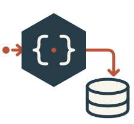

<!-- You found the source. The penguin insists this counts as code review. -->

  <picture>
    <source media="(prefers-color-scheme: dark)" srcset="https://cdn.jsdelivr.net/gh/codewithmahad/codewithmahad@70c53829fb871ceaafae30382591dc2632aa0525/assets/profile/masthead-dark.svg">
    
  </picture>

**I’m Shaikh Mahad Ud Din**, a developer from Karachi, Pakistan, focused on **Java and Spring Boot**.

I started with native Android apps in Kotlin and Jetpack Compose. Building screens got me interested in the part I couldn’t see: how an application decides who can do what, where its data belongs, and what happens when a request goes wrong.

That curiosity is what brought me to backend development. I build Spring Boot APIs, work with relational databases, and keep pulling apart the pieces until I can explain how they fit. I want to follow a request from the controller to the database and understand the service logic, security rules, and queries along the way.

A little more about my path

**BS Software Engineering at UBIT, University of Karachi** brought programming, databases, and operating systems into the same picture for me. My repositories give me somewhere to keep working through them.

The Android chapter is still here:

- **[Derivify](https://github.com/codewithmahad/Derivify-Calculus-Toolkit)**: a native Android toolkit for multivariable calculus, built with Kotlin and Jetpack Compose.
- **[Quizzler](https://github.com/codewithmahad/Quizzler-App)**: the quiz app I built for my second-semester OOP project.

I also founded **The UBIT Hub**. Sharing notes and building small tools for that community is another reason I keep making things.

  

### What I use

<!-- Keep this row focused on the core stack. Add tools to the categories below after using or studying them. -->
<table>
  <tr>
    <td align="center" valign="top" width="180"> <strong>Java</strong></td>
    <td align="center" valign="top" width="180"> <strong>Spring Boot</strong></td>
    <td align="center" valign="top" width="180"> <strong>PostgreSQL</strong></td>
    <td align="center" valign="top" width="180"> <strong>Linux</strong></td>
  </tr>
</table>

More tools & current focus

| Area | Tools and how I use them |
| :--- | :--- |
| **Languages** | <a href="https://dev.java/">&nbsp;Java</a> &nbsp; <a href="https://www.gnu.org/software/bash/">&nbsp;Bash</a> Java for backend code; Bash for Linux scripts and deployment automation. |
| **Frameworks & libraries** | <a href="https://spring.io/projects/spring-boot">&nbsp;Spring&nbsp;Boot</a> &middot; Spring Security &middot; MapStruct REST APIs, authentication, access rules, and DTO mapping. |
| **Databases** | <a href="https://www.postgresql.org/">&nbsp;PostgreSQL</a> &nbsp; <a href="https://www.mysql.com/">&nbsp;MySQL</a> SQL for schema design and queries; Flyway for database migrations. |
| **Tools & environment** | <a href="https://git-scm.com/">&nbsp;Git</a> &nbsp; <a href="https://maven.apache.org/">&nbsp;Maven</a> &nbsp; <a href="https://www.kernel.org/">&nbsp;Linux</a> &nbsp; <a href="https://www.postman.com/">&nbsp;Postman</a> &nbsp; <a href="https://www.jetbrains.com/idea/">&nbsp;IntelliJ&nbsp;IDEA</a> Version control, builds, Linux environments, API requests, and everyday development. |

**Current focus:** Java internals, DSA, design patterns, and query performance. I work through these alongside my projects and keep the notes in my lab repositories.

<h2><a href="https://github.com/codewithmahad/spring-boot-25-enterprise-template"><picture><source media="(prefers-color-scheme: dark)" srcset="assets/profile/backend-flow-dark.svg"></picture></a>Backend projects</h2>

  <a href="https://github.com/codewithmahad/spring-boot-25-enterprise-template"><strong>Spring Boot Starter ↗︎</strong></a> 
  A reusable starting point with separated layers, database migrations, and API documentation. The setup I don’t want to repeat for every new idea.

Inside the starter

**Spring Boot Starter:** Java, Spring Boot, Flyway, MapStruct, and OpenAPI. It brings together the project structure, migration setup, mapping, and documentation I want ready before starting the next backend.

**What I’m paying attention to:** where controller, service, and repository responsibilities meet; what data crosses those boundaries; and how access and validation rules fit into the request flow.

The repository has its own setup instructions and implementation details.

<h2 id="the-notebook-stays-open">Learning notes</h2>

  <a href="https://github.com/codewithmahad/LINUX_LAB"><strong>LINUX_LAB ↗︎</strong></a> started in my Operating Systems lab. It’s where I work through commands, permissions, processes, and Bash scripts and write the explanation I wish I’d had when something didn’t make sense.
   

  Other notebooks:
  <a href="https://github.com/codewithmahad/JAVA_LAB"><strong>Java</strong></a> ·
  <a href="https://github.com/codewithmahad/SQL_LAB"><strong>SQL</strong></a> ·
  <a href="https://github.com/codewithmahad/DSA_LAB"><strong>Data structures & algorithms</strong></a>

<h2 id="practical-projects"><a href="https://github.com/codewithmahad/deploylatch"><picture><source media="(prefers-color-scheme: dark)" srcset="https://cdn.jsdelivr.net/gh/codewithmahad/deploylatch@5c9f7a45866382327fe0de5911df684a2674dec8/docs/assets/deploylatch-mark-on-dark.svg"></picture></a>Practical projects</h2>

  <a href="https://github.com/codewithmahad/deploylatch"><strong>DeployLatch ↗︎</strong></a> 
  A Bash tool that deploys a Java service on Ubuntu, verifies the release, and rolls back failed updates. I built it for my Operating Systems course to put the Linux and scripting work from <a href="https://github.com/codewithmahad/LINUX_LAB">LINUX_LAB</a> into practice. 
  <a href="https://github.com/codewithmahad/deploylatch#deployment-demo">See the Ubuntu rollback demo →</a>
   

<h2 id="some-things-are-better-shared">The UBIT Hub</h2>

  
  I founded <strong>The UBIT Hub</strong>, a community connecting <strong>900+ UBIT students</strong> through course support, academic discussion, and peer learning.

  Good notes shouldn’t disappear into an old group chat after finals. <a href="https://github.com/codewithmahad/the-ubit-hub-resources"><strong>Our shared resources</strong></a> collect notes, assignments, and lab material for the next person who needs them.
   

The resources and tools behind the community

The resource repository gives course material a place people can return to. It’s the same reason I keep my own learning notes: something that took time to understand should be easier for the next person to find.

I also built the **[UBIT Semester Results Dashboard](https://github.com/codewithmahad/ubit-semester-result-dashboard)** using **Next.js and TypeScript**, with GPA calculations, rankings, and PDF exports.

These projects connect the two parts of my GitHub: learning how things work, and making something useful with what I learn.

  <picture>
    <source media="(prefers-color-scheme: dark)" srcset="assets/profile/contact-heading-dark.svg">
    
  </picture>

If a repo helped you or sparked an idea, I’d like to hear about it. [Follow my work](https://github.com/codewithmahad) or get in touch below.

  <a href="https://shaikhmahad.vercel.app"><picture><source media="(prefers-color-scheme: dark)" srcset="assets/profile/contact/portfolio-dark.svg"></picture></a>
  <a href="https://www.linkedin.com/in/codewithmahad"><picture><source media="(prefers-color-scheme: dark)" srcset="assets/profile/contact/linkedin-dark.svg"></picture></a>
  <a href="mailto:codewithmahad@gmail.com"><picture><source media="(prefers-color-scheme: dark)" srcset="assets/profile/contact/email-dark.svg"></picture></a>

Coding profiles & practice

  <a href="https://leetcode.com/u/mahad2006/">&nbsp;LeetCode</a> &nbsp;&nbsp;
  <a href="https://www.hackerrank.com/codewithmahad"><picture><source media="(prefers-color-scheme: dark)" srcset="https://cdn.jsdelivr.net/gh/codewithmahad/codewithmahad@70c53829fb871ceaafae30382591dc2632aa0525/assets/profile/practice/hackerrank-wordmark-dark.svg"></picture></a> &nbsp;&nbsp;
  <a href="https://www.geeksforgeeks.org/user/codewithmahad/">&nbsp;GeeksforGeeks</a> &nbsp;&nbsp;
  <a href="https://codolio.com/profile/codewithmahad">&nbsp;Codolio</a>

Psst. There’s one more drawer.

<picture>
  <source media="(prefers-color-scheme: dark)" srcset="https://cdn.jsdelivr.net/gh/codewithmahad/codewithmahad@70c53829fb871ceaafae30382591dc2632aa0525/assets/profile/drawer-compact-dark.svg">
  
</picture>

  <a href="https://github.com/codewithmahad/LINUX_LAB"><strong>Follow the penguin →</strong></a> a Linux rabbit hole. 
  <a href="https://github.com/codewithmahad/spring-security-jwt-mastery"><strong>Take the spare key →</strong></a> a look at authentication. 
  <a href="https://github.com/codewithmahad/the-ubit-hub-resources"><strong>Pass the note →</strong></a> something useful for the next student.

<!-- Bonus drawer: thanks for reading the small print. See you in the commit history. -->

<h3 id="a-keyboard-habit">From 60 to 120+ WPM</h3>

I started learning **touch typing in 2023**, at around **60 WPM**, before joining Monkeytype. Reaching **120+ WPM** came gradually with practice. Day to day, I notice fewer interruptions: I can keep my attention on a command, a sentence, or the problem I’m working through. That helps with code, lecture notes, and emails. Start with [a short test](https://monkeytype.com/), work on accuracy, and come back for a few minutes regularly. Keep your first score. It’s satisfying to look back at it later. Come find me on Monkeytype: 

© 2026 Shaikh Mahad Ud Din · All rights reserved · <a href="LICENSE.md">Copyright</a> <a href="#top">Back to the desk ↑</a>

